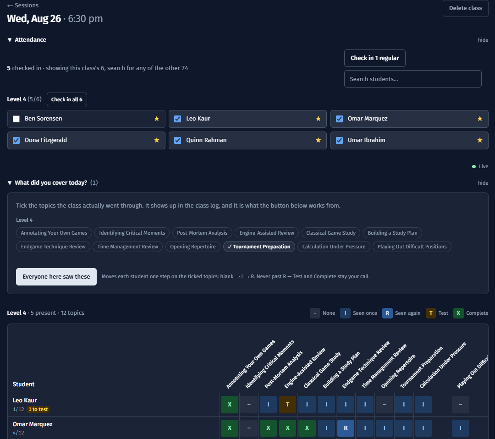
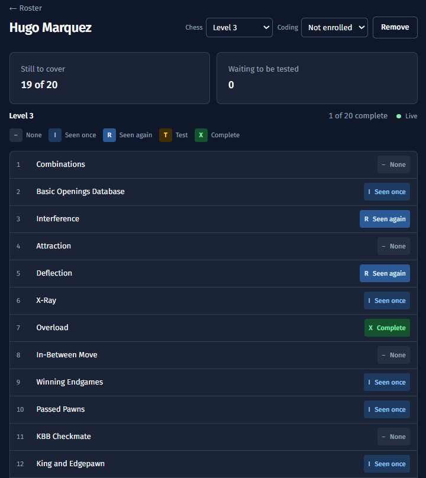
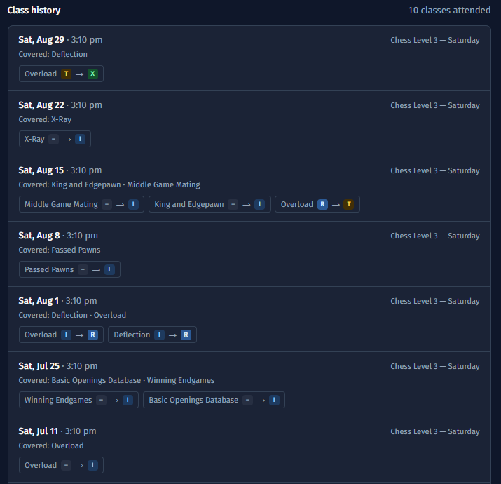
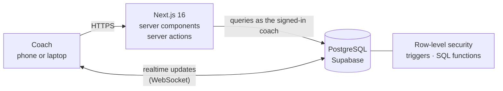
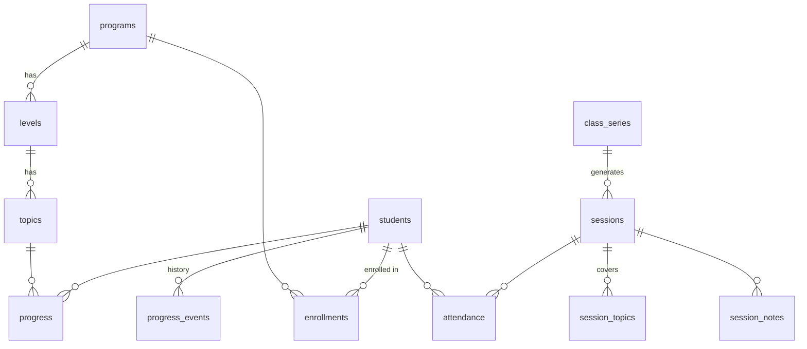

# Chess Progress

[](https://github.com/NikhilGG123/chess-progress/actions/workflows/ci.yml)

**A live database and web app that replaced a chess academy's Excel workbook
for tracking what every student has learned.**

Coaches run a class from a phone or laptop: check students in, record what the
lesson covered, and mark each child's progress topic by topic. Every mark is
saved to a permanent, per-student record in PostgreSQL instead of a cell on a
spreadsheet tab.

**[Live demo →](https://chess-dashboard-mu.vercel.app)** · sign in as
`brad@example.com` / `ChessCoach2026!` · every student in the demo is invented



| | |
| --- | --- |
| **Status** | Deployed for the academy, running on their real records |
| **Data migrated** | 645 students · 12,398 progress marks · 2,196 attendance records · 523 classes |
| **Built with** | TypeScript, Next.js 16, React 19, PostgreSQL (Supabase), Python, Tailwind CSS |
| **Role** | Sole developer: requirements with the coaches, data model, app, data migration, deployment |

---

## Why it exists

The academy teaches chess across four levels, with 12 to 22 topics per level
and fourteen classes a week. Progress lived in a shared Excel workbook with one
tab per level, which caused three problems:

- **A student's history was split across tabs.** Moving up a level meant
  starting a new row on a new tab, so one child's record ended up in several
  places.
- **Names drifted.** Years of first names only, then last initials, left the
  same child filed as "Rohan", "Rohan M" and "Rohan Mistry".
- **No history.** A cell held a student's current mark, with no record of when
  it changed or in which class.

This app replaces the workbook with a relational database: one record per
student, every change timestamped, and a screen built around running a class.

---

## Features

### Running a class

- **Today screen.** Opens on the classes happening today, in the coach's own
  time zone.
- **One-tap check-in.** Each class has starred "regulars" who can be checked in
  together; drop-ins are found by search.
- **Topics covered.** The coach ticks what the lesson covered, which becomes
  part of the class log.
- **"Everyone here saw these."** One button moves every attendee forward on the
  covered topics. It is capped by the database so it can never mark a student
  as tested or complete; that stays a coach's judgement.
- **Progress grid.** One row per student, one column per topic, with a
  five-step scale: not seen, seen once, seen several times, ready to test,
  complete.
- **Live between devices.** Two coaches can work the same class on two devices;
  marks and check-ins appear on both screens in real time.
- **Per-student notes** for each class, saved automatically as the coach types.

### Student records

<p>
  
  
</p>

- **Student page.** Progress at every level the student has been through, not
  just the current one.
- **Class history.** Every class attended, newest first, with which marks
  changed that day.
- **Programmes.** A student can be enrolled in several programmes (chess and
  coding, say), each with its own level.
- **Follow-up flag.** A single checkbox meaning "check this student in the
  registration system". It deliberately stores no payment details.

### Cleaning up duplicate records

- **Duplicate review screen.** Groups records with matching names and shows the
  evidence side by side: levels, attendance dates and progress.
- **Merge.** A coach confirms each merge. Marks, attendance, notes and history
  move to the surviving record first, and where both records marked the same
  topic, the more advanced mark is kept.

### Scheduling and curriculum

- **Repeating classes.** Define a weekly class once and the sessions are
  generated weeks ahead. A cancelled week stays cancelled.
- **Editable curriculum.** Coaches add, rename and reorder programmes, levels
  and topics in the app, with no code changes.

### Safety and administration

- **Two roles.** Coaches do everything needed day to day. Deleting a topic,
  level or student needs a separate Admin account, because those deletes
  cascade into every affected student's record.
- **Clear delete warnings.** Instead of "Are you sure?", a delete states what
  will be lost ("3 students checked in, 2 notes").
- **Recoverable deletes.** Every deleted row is copied to an archive table by
  the database first, with who deleted it and when.
- **Backups.** One-click download of the whole database from the Admin page,
  plus a script to snapshot and restore it.
- **Dark mode**, and layouts that work on a phone in the classroom.

---

## Architecture



- **Server-rendered pages, server actions for writes.** The browser holds only
  a publishable key; every query runs with the coach's own session, so
  database access rules apply to everything.
- **Business rules live in the database.** Progress history, the archive of
  deleted rows, the cap on the bulk advance and the merge are triggers and SQL
  functions. They apply however the data is changed: through the app, an import
  or a manual SQL query.
- **Two deployments of one codebase.** The public demo runs on Vercel with
  generated data. The academy's instance runs on Cloudflare Workers against its
  own database.

### Data model



The key decision: **progress belongs to a topic, not to a level.** A student
has one row per topic, and the topic knows its level. Promoting a student
therefore changes no progress rows, and their earlier levels remain as history
automatically.

---

## Engineering highlights

- **Security in two layers.** Row-level security policies decide *which rows* a
  user can touch; table `GRANT`s decide whether they can touch the table at
  all. Both are set explicitly for every table, and the anonymous role has no
  access to any of them.
- **Silent row limits.** Supabase's API returns at most 1,000 rows without any
  error. One class of 46 students on a 22-topic level is 1,012 progress rows,
  so every query that grows with the roster pages through results explicitly
  rather than quietly losing the tail.
- **Realtime that respects permissions.** Live updates are re-checked against
  each coach's access rules, so the socket is opened only after the coach's
  session is restored. Otherwise it connects but never receives anything.
- **Dates without time-zone bugs.** Postgres dates have no time zone, and
  JavaScript would read them as UTC midnight, showing a class on the 3rd as the
  2nd anywhere west of Greenwich. "Today" is calculated on the coach's device,
  not the server.
- **Database tests against a real Postgres.** 44 of the 65 tests run against a
  live database inside a transaction that is rolled back, so they can safely be
  pointed at production. They cover access rules and roles, the bulk-advance
  cap, progress history, the archive of deleted rows, merging, and the
  1,000-row limit.
- **No real data in the repository.** A script checks every tracked file
  against the names on the academy's roster.

---

## Migrating the academy's data

Moving 645 students off the old system was as much a data problem as a
software one.

**Checking the meaning of the marks.** The coaches mark completion with `X`. An
outsider reads `X` as a cross, and an early version of this app made exactly
that mistake, which would have inverted every student's record on import. The
meaning was confirmed from three independent sources: the coaches, the
workbook's own formulas, and 3,702 records labelled *Completed* in the old
database. A test now pins it.

**Deciding not to merge automatically.** Many students appeared as several
records with similar names. Before building anything, I tested whether
attendance history could identify the true duplicates safely:

| Same-name groups at different levels | 126 |
| :--- | ---: |
| Attended in separate periods (consistent with one child moving up) | 10 |
| Attended in the *same* week on two records | 7 |
| Too little attendance to tell | 109 |

Even the 7 prove nothing, because 27 students legitimately attend two classes a
week. With no reliable second key, and with merging two different children far
worse than leaving one child split, the app gives coaches a review screen
instead of merging automatically.

**Verifying the import.** Every count was checked against the source after the
import. Marks matched exactly by category:

| Not seen | Seen once | Seen several times | Ready to test | Complete |
| ---: | ---: | ---: | ---: | ---: |
| 4,951 | 2,435 | 678 | 632 | 3,702 |

The importer only reads from the old system, and its output is never committed.

---

## Running it locally

Requires Node.js 20 or later and a free [Supabase](https://supabase.com)
project.

```bash
git clone https://github.com/NikhilGG123/chess-progress.git
cd chess-progress
npm install
cp .env.example .env.local     # add your Supabase URL, keys and database URL

node scripts/apply-sql.mjs supabase/migrations/*.sql          # schema
node scripts/apply-sql.mjs supabase/seed/001_placeholder_seed.sql  # demo data

npm run dev                    # http://localhost:3000
```

There is no public sign-up: accounts are created in the Supabase dashboard and
given a row in the `coaches` table.

| Command | |
| --- | --- |
| `npm test` | 65 tests: unit tests, plus database tests when credentials are set |
| `npm run build` | production build |
| `npm run lint` · `npm run typecheck` · `npm run format` | ESLint, TypeScript, Prettier |
| `node scripts/generate_demo_seed.mjs` | regenerate the demo data |
| `node scripts/backup.mjs` | snapshot every table to a JSON file |

The demo data simulates a twelve-week term rather than random values, so it is
internally consistent: no student is ahead on a topic their class never
covered.

---

## Project structure

```
app/                Next.js routes: pages and server actions
components/         UI, grouped by area: sessions/, students/, curriculum/, ...
hooks/              realtime subscription, local date, remembered toggles
lib/                queries (paginated), the five marks, shared types
supabase/
  migrations/       18 SQL migrations: schema, security, triggers, functions
  seed/             generated demo data
scripts/            data import, backups, demo data generator
tests/              unit tests and rolled-back database tests
```

[CLAUDE.md](CLAUDE.md) holds the full design notes: the domain, the schema,
the access model, and the mistakes this codebase has already made once.

---

## What's next

- **Learning analytics.** Every change is already timestamped in
  `progress_events`, which makes it possible to measure time-to-mastery per
  topic and spot topics where students stall.
- **End-to-end tests** of the class workflow in a real browser.
- **Parent-facing progress reports**, generated from the same records.
